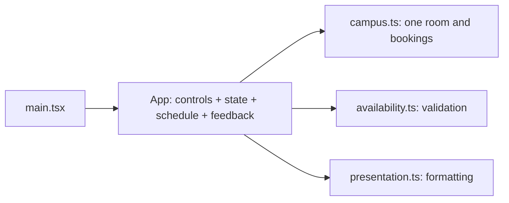
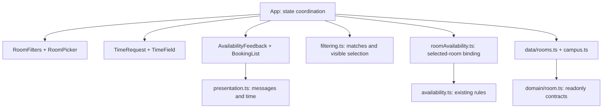

# Assignment 04
## Smart Campus Room Availability Checker

**Software Engineering | AI-assisted software evolution and quality improvement**

Dastan Karbuzov | Student ID: 24B031050
Class: Tuesday, 16:00-19:00 | Date: 8 November 2026 (Asia/Almaty)
AI assistant: OpenAI Codex (GPT-6; exact model build not exposed).

The working single-room application was extended to four fictional rooms, with capacity and ALL-item equipment filtering. Each selected room uses its own booking list and blocked status. The interface presents clear available, overlap, blocked and no-match states, and works on desktop and narrow mobile screens.

The starting version is the existing Practice 09 continuation of the repaired Practice 08 / Assignment 03 Smart Campus prototype. The package includes both source snapshots. This is feature extension and refactoring, not a repeat of the debugging exercise. No new Agent Skill was created.

### Fictional room catalog

| ID / Room | Seats | Equipment | Status |
| --- | --- | --- | --- |
| library-a / Library Study Room A | 8 | Projector, Whiteboard | Open |
| innovation / Innovation Studio | 20 | Projector, Whiteboard, Video conferencing | Open |
| computer-lab / Computing Lab | 12 | Computers, Whiteboard | Open |
| seminar-hall / Seminar Hall | 40 | Projector, Video conferencing | Blocked |

### Verified outcome

| Evidence | Actual result |
| --- | --- |
| Original automated suite | 26 / 26 passed |
| Final automated suite | 61 / 61 passed, including 12 mounted UI checks |
| Finite-input before/after comparison | 5,610 matching decisions; fixtures unchanged |
| Real Chromium browser assertions | 13 / 13 passed |
| TypeScript / ESLint / production build | All passed |

The fixed demo clock remains 27 October 2026, 10:00 in the browser's local timezone. No login, database, external data API, reservation creation or persistence is introduced. All bookings and owners are fictional.

<!-- pagebreak -->

# 01 / Codebase analysis

Before implementation, the assistant received the repository map, AC1-AC6, F1-F5 and scope constraints. The time-stamped pre-edit context and prioritized plan are preserved in **evidence/00-context-and-plan.md**. The unchanged baseline was tested before source edits.

### Repository map and maintainability risks

| Source / function | Risk and impact | Planned improvement |
| --- | --- | --- |
| initial/src/App.tsx / App, handleCheck | One ROOM_NAME and one bookings array couple selection and checking; adding rooms can use unrelated data. | Typed catalog; checkRoom takes one Room. |
| initial/src/App.tsx / App | Inputs, schedule, result and state coordination live in the same component. | Extract focused presentation components. |
| initial/src/App.tsx / datetime controls | Two repeated label/input blocks and repeated result invalidation can diverge. | One TimeField renderer and changeTime handler. |
| initial/src/lib/availability.ts / AvailabilityInput | Mutable Booking[] conflicts with a no-mutation contract. | Accept readonly bookings; freeze catalog fixtures. |
| initial/src/lib/availability.ts / isAvailable | Ordering alone does not reject every non-finite timestamp. | Add finite guards with dedicated tests. |

### Prioritized plan, recorded before edits

1. P0: preserve initial source and execute baseline tests.
2. P1: add four-room data and independent capacity / ALL-equipment filtering.
3. P2: separate presentation; derive selected room and current checked feedback.
4. P3: retain regressions; execute boundaries, mounted UI checks, static checks and behavior comparisons.
5. P4: verify browser flows; capture actual screenshots; document measured results and package the work.

### AI suggestion modified

A design alternative considered by the assistant was storing a full selected Room object and a separate last AvailabilityResult in React state. It was rejected before implementation because both can become stale when requirements change. The final version stores a preferred room ID and a checked flag; selectedRoom and result are derived from current inputs. Plain functions and composition were sufficient; additional policy classes were rejected as unnecessary.

### Preserved acceptance contract

AC1: finite start < end, start >= fixed NOW. AC2: duration <=120 minutes. AC3: blocked rooms unavailable. AC4: intervals are half-open; strict overlap is rejected, touching endpoints allowed. AC5: checking never mutates or reorders bookings. AC6: responsive controls, meaningful feedback and no stale time result. The start-at-NOW behavior is inherited from the actual working baseline.

<!-- pagebreak -->

# 02 / Feature extension and refactoring

F1 uses capacity >= attendees, including exact capacity. F2 uses equipment.every, so every requested item must exist. Invalid attendee values produce a useful error and no matches. F3 keeps matching blocked rooms visible with a badge while checkRoom rejects them. F4 shows an explicit empty state, removes old feedback and disables checking. F5 refreshes the result and schedule when the selected room changes.

### Before: single-room application



### After: explicit responsibilities



### Design decisions

**1. Keep rules pure and bind data explicitly.** checkRoom(room, start, end, now) passes that room's bookings and blocked flag into isAvailable. Filtering is a separate pure function because room suitability and time conflicts are different decisions. The room-switch test uses the same interval: Library is free while Innovation overlaps.

**2. Derive feedback instead of duplicating state.** Once a check is requested, room and filter changes recalculate current feedback. Time edits clear checked until the next explicit check. When filtering hides the preferred room, the first visible match becomes selected; no match means no selection. This keeps selection, schedule and feedback synchronized.

**3. Share rendering and protect fixtures.** Two datetime-input implementations become one TimeField definition. Room types and fixture arrays are readonly; fixture objects are also frozen at runtime. BookingList sorts a copy. All original test files and finite-time rules remain intact. Only non-finite timestamp handling is deliberately stricter.

<!-- pagebreak -->

# 03 / Automated regression testing

All tests were executed, not only proposed. The final suite consists of 26 retained tests, 23 new pure-function cases and 12 mounted React integration cases. Original test files are byte-identical between initial and final snapshots.

| Requirement / boundary | Executable evidence | Outcome |
| --- | --- | --- |
| AC1: equal / reversed / past / missing time | availability.test.ts; practice09.test.ts; App.test.tsx | Pass |
| AC1: NaN and infinite timestamps | assignment04.test.ts, parameterized finite guards | Pass |
| AC2: exactly 120 vs 121 minutes | practice09.test.ts: exact reason and accepted boundary | Pass |
| AC3 / F3: blocked matching room | assignment04.test.ts and mounted blocked-room check | Pass |
| AC4: touching at either endpoint vs overlap | availability.test.ts and one-minute regression | Pass |
| AC5: frozen unsorted bookings, identities, repeated checks | original regressions; catalog and mounted tests | Pass |
| F1: capacity 8 vs 9; 40 vs 41 | pure and actual attendee input checks | Pass |
| F2: ALL equipment and impossible combination | pure and checkbox integration checks | Pass |
| F4: no rooms, disabled check, removed stale feedback | App.test.tsx empty-state behavior | Pass |
| F5: switching, filtering away selection, own schedule | App.test.tsx and real browser assertions | Pass |
| AC6: time edits clear feedback; responsive layouts | mounted tests and 320/390/768/1440px browser checks | Pass |

### Actual commands and recorded results

```sh
# In initial/: 26/26
npm test -- --reporter=verbose
# In final/: 61/61; remaining commands exit 0
npm test -- --reporter=verbose
npm run typecheck
npm run lint
npm run build
# In the submission root: 5,610/5,610 decisions
node --experimental-strip-types evidence/compare-behavior.mjs
# With initial :5183 and final :5184 running: 13/13
python3 evidence/check-browser.py
```

Exact output is in **evidence/01-baseline-tests.txt** through **08-browser-console.txt**, plus browser JSON transcripts. check-browser.py drives the gstack /browse tool and asserts actual DOM states. No console errors were reported in that tested session.

The differential script samples 85 start offsets, 11 durations, two blocked states and three booking fixture sets: 85 x 11 x 2 x 3 = 5,610. It asserts identical finite-input results and unchanged frozen fixtures. This is sampled regression evidence, not an exhaustive proof over all timestamps.

<!-- pagebreak -->

# 04 / Evidence-based quality evaluation

| Measure | Initial | Final | How obtained |
| --- | --- | --- | --- |
| Automated tests passed / total | 26 / 26 | 61 / 61 | Actual Vitest logs; no tests removed. |
| Executed mounted UI tests | 0 | 12 | App.test.tsx and verbose runner output. |
| Physical datetime-input render locations | 2 | 1 | Count literal type="datetime-local" in production TSX. |
| Duplicated rendering locations removed | Baseline | 1 | Second repeated input block replaced by shared TimeField. |
| Production TS/TSX modules | 5 | 14 | Recursive source listing excluding tests and .d.ts. |
| Room catalog size | 1 | 4 | Data fixtures and catalog integrity test. |
| Real-browser assertions for new version | Not applicable | 13 / 13 | Browser assertion JSON and command transcript. |

**Structural interpretation.** More files are not automatically higher quality. The final boundaries give one clear responsibility each: room fixtures, domain contracts, filtering / visible selection, selected-room binding, availability rules and presentation. App coordinates rather than owns all JSX. Five component files export six focused UI components; TimeField shares the repeated controls. The count of 14 production modules also includes main.tsx and the retained baseline fixture/presentation helpers.

**Reproducibility.** evidence/measure-quality.py reproduces module and duplicate-render counts and checks test-count strings against actual logs. evidence/quality-metrics.json lists every counted module. The duplication measure is deliberately narrow: it is not a clone-detector score, and no unsupported percentage or performance improvement is claimed. Before/after diagrams and evidence/source.diff allow direct inspection.

### Remaining limitations

- The fixed local clock preserves the original prototype behavior. It does not model an explicit campus IANA timezone or daylight-saving transitions; display may differ by browser locale.
- The catalog is fictional, in memory, and readonly. It is an availability checker, with no reservations, persistence or concurrent users, as required by scope.
- Automatic fallback picks the first matching room when the preferred room is hidden. A future interface could announce this transition explicitly.
- DOM integration and real browser checks cover the demonstrated behavior and widths. Keyboard focus styles and labels exist, but no screen-reader or full accessibility audit was performed.
- Test execution and review were performed by the assistant. Independent student verification has not been performed or claimed.

### Verification boundaries

Expected-output tests and comparison against the earlier implementation reduce reliance on AI recommendations. Raw logs, scripts, screenshots and file hashes support review. No deployment, email delivery, external reviewer approval or coverage percentage is claimed.

<!-- pagebreak -->

# 05 / AI use and reflection

Tool: **OpenAI Codex, GPT-6**, used on **8 November 2026**. gstack /browse supplied real Chromium checks; ReportLab and Poppler supplied PDF authoring and visual verification. The full selected-request/context summaries, decisions, corrections and verification sources are in **report/AI_Appendix.md**.

| Input / instruction summary | AI output used | Review or correction |
| --- | --- | --- |
| Inspect working prototype with AC1-AC6 / F1-F5 constraints | Map, baseline, risks and prioritized plan | Original source snapshot and 26 baseline tests. |
| Extend rooms; separate filtering, rules, data and UI | Four-room catalog, pure functions and components | Derived feedback chosen instead of stale result state. |
| Preserve behavior and add executable checks | 35 new tests; equivalence and browser scripts | 61 tests, 5,610 comparisons, 13 browser assertions. |
| Document measured engineering quality | Report, reflection, appendix and package | Counts tied to scripts and actual execution logs. |

### Reflection (248 words, AI-assisted)

<!-- reflection -->

### Authorship and review record

The user's request delegated the implementation and documents to AI. All recorded checks were executed by the assistant; independent student review is not claimed. The appendix distinguishes the actual user request from internal context summaries and does not fabricate separate conversations. The package includes ready-to-copy submission email text; it has not been sent.

<!-- pagebreak -->

# 06 / Browser evidence: desktop workflow

Real Chromium capture through gstack /browse. At the default 10:30-11:00 interval, the library is available. The four room cards display their capacities, equipment and blocked status. The source image is **screenshots/10-desktop-workflow.png**, an element capture of the main column at a 1440px viewport.

<!-- image:10-desktop-workflow.png:440:540 -->

The full desktop layout, including the room-specific schedule, is preserved in **02-final-desktop-available.png**. The original single-room screen is in **01-initial-desktop.png**. The actual room switch and overlap feedback are in **03-room-switch-overlap.png**.

<!-- pagebreak -->

# 07 / Browser evidence: filtering

The same real browser session demonstrates successful and unsuccessful filtering. Original full-resolution images and command transcripts are included in the archive.

<!-- filter-pair -->

**Left: capacity + ALL equipment.** With 20 attendees, Projector and Whiteboard selected, only Innovation Studio matches. Its own 10:30-11:00 booking correctly produces an overlap. Library has insufficient capacity; the lab lacks a projector; the hall lacks a whiteboard.

**Right: clear empty state.** Increasing attendees to 41 removes all rooms, shows "No rooms match your requirements", removes stale feedback and disables checking. The separate schedule panel changes to "No room selected". Reset filters restores all four rooms.

Sources: **screenshots/11-filters-workflow.png**, **12-empty-workflow.png**, and full-layout **04-successful-filters.png**, **05-empty-state.png**. These are actual screenshots, not interface mockups.

<!-- pagebreak -->

# 08 / Browser evidence: responsive feedback

Real 390 x 844 viewport captures after scrolling to the result and schedule. The blocked hall is unavailable; switching to the computing lab immediately refreshes the result and shows only its booking. Full-page mobile screenshots are also included.

<!-- mobile-pair -->

**Blocked hall:** the feedback explains blocked status, and the schedule displays Film Society. **Available lab:** the same interval is free, and the schedule displays Coding Circle. The input catalog is unchanged by either check.

No horizontal overflow was observed at widths **320, 390, 768 and 1440 px**. These assertions and the selected-room transitions are recorded in evidence/07-browser-checks.json. The final browser console check reported no console errors.

Sources: **screenshots/08-mobile-blocked-detail.png** and **09-mobile-available-detail.png**. Full-page sources: **06-mobile-blocked.png** and **07-mobile-available.png**.
